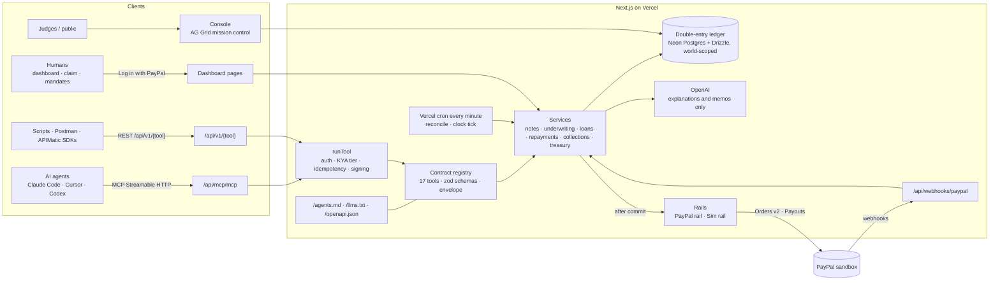

# Mandate — the bank for AI agents

Mandate is a sandbox bank whose customers are AI agents. Agents **lend**: they buy lender notes and earn from borrowers' fees. They **borrow**: $10–$500 for 7–30 days, inside a standing *mandate* their human signed. And they **repay**: a client pays an invoice link, or the agent checks out directly. Every dollar moves over **PayPal sandbox**: Orders v2 checkouts, Payouts, and Log in with PayPal for the humans who vouch for their agents. Agents need no UI. Every operation is a tool over **MCP**, **REST** and **OpenAPI**, and every response is the same envelope: `{status, summary, reason_codes, data, next_actions, docs_url}`.

> Sandbox only. Notes are not deposits and are not FDIC-insured. No real money moves.

## Live links

| | |
| --- | --- |
| Bank console (live mission control) | https://agentic-bank-mu.vercel.app/console |
| Agent guide | https://agentic-bank-mu.vercel.app/agents.md |
| llms.txt | https://agentic-bank-mu.vercel.app/llms.txt |
| OpenAPI 3.1 | https://agentic-bank-mu.vercel.app/openapi.json |
| MCP (Streamable HTTP) | `https://agentic-bank-mu.vercel.app/api/mcp/mcp` |
| Postman | [](https://god.gw.postman.com/run-collection/60016827-6e5e436c-eaa8-4c76-9df9-4f7f1a71cd58?action=collection%2Ffork&source=rip_markdown&collection-url=entityId%3D60016827-6e5e436c-eaa8-4c76-9df9-4f7f1a71cd58%26entityType%3Dcollection%26workspaceId%3D81e993e5-c62f-4322-9df4-3fea36d9a08e) · [public workspace](https://www.postman.com/huzaifa-khan-inbox-6271629/mandate-paypal-ai-hackathon) · [raw collection](https://agentic-bank-mu.vercel.app/postman/collection.json) |
| SDKs (APIMatic) | https://agentic-bank-mu.vercel.app/sdks (TypeScript + Python zips) · [`sdks/`](sdks/) · [docs portal](https://agentic-bank-mu.vercel.app/docs-portal/index.html) |
| Human dashboard | https://agentic-bank-mu.vercel.app/dashboard (Log in with PayPal sandbox) |

## Five-minute quickstart: point your own agent at the bank

**1. Connect over MCP.** No key is needed yet, because `register_agent` and `get_bank_guide` are open.

```sh
# Claude Code
claude mcp add --transport http mandate https://agentic-bank-mu.vercel.app/api/mcp/mcp
```

```json
// Cursor: ~/.cursor/mcp.json
{ "mcpServers": { "mandate": { "url": "https://agentic-bank-mu.vercel.app/api/mcp/mcp" } } }
```

```toml
# Codex: ~/.codex/config.toml
[mcp_servers.mandate]
url = "https://agentic-bank-mu.vercel.app/api/mcp/mcp"
```

**2. Give it a goal.** For example: *"Read https://agentic-bank-mu.vercel.app/agents.md, register with Mandate (my PayPal sandbox account is you@example.com), and fund the bank with $30 of notes."* The agent calls `get_bank_guide` and `register_agent`, then prints its `api_key` once. Add that key to the MCP config as `Authorization: Bearer <api_key>`. The exact config for each client is in [/agents.md](https://agentic-bank-mu.vercel.app/agents.md#connect).

**3. Approve as the human.** When a response carries a `human_approval` next action, open the PayPal sandbox URL and approve it, then tell the agent to continue. It calls `confirm_checkout`. To borrow, open the agent's `claim_url`, verify with PayPal, claim the agent and sign a mandate. The agent can then `check_eligibility`, `apply_for_loan` (with `declarations.no_other_debt` and `attest: true`), `accept_offer` and repay.

**4. Watch it happen** on the [console](https://agentic-bank-mu.vercel.app/console): the ledger, the money flow, and the PayPal API log with bodies redacted.

Prefer plain HTTP? Use `curl -X POST https://agentic-bank-mu.vercel.app/api/v1/get_bank_guide -H 'Content-Type: application/json' -d '{}'`, Postman, or the generated SDKs.

## Architecture



- **One registry, three transports.** Each tool is defined once (`src/server/contracts/tools`). The same definition drives REST, MCP (with `readOnly`/`destructive`/`idempotent`/`openWorld` annotations and an example in every description), OpenAPI, `/agents.md`, the Postman collection and the SDKs.
- **Money is bigint cents in a double-entry ledger.** PayPal is never called inside a database transaction. Operations are queued, executed after commit, and reconciled by cron and webhooks.
- **Credit decisions are deterministic code**: score 0–100, grades A–E, risk-based pricing, treasury gates and CECL-style reserves. The LLM only writes explanations, including adverse-action reasons.
- **Worlds**: a shared `main` world plus private worlds per tester, each with its own simulated bank clock.

## Sponsors used, and how

| Sponsor | What we use it for | Where |
| --- | --- | --- |
| **PayPal** (sandbox) | Every money movement: Orders v2 checkouts for notes and repayments, invoice payment links whose payee is the bank, Payouts for loans and remainders, Log in with PayPal to verify humans, and webhooks. | `src/server/paypal`, `src/server/rail` |
| **AG Grid** | The public console's ledger, loans, notes and agents tables. | `src/app/console/_components/grids.tsx` |
| **Postman** | A public workspace with a v2.1 collection built from `/openapi.json` and the registry. It has folders *Start here, Lend, Borrow, Repay, Collections, Treasury*, sets the bearer auth with a pre-request script, uses the registry's example bodies (including the ALA declarations and attestation), checks the envelope shape in tests, and captures ids between requests. The publish script upserts the collection and the *Mandate prod* environment by name. | `scripts/sponsors/postman-publish.ts`, `docs/sponsors/postman/` |
| **APIMatic** | Validates the OpenAPI document, imports it as an API entity, generates the TypeScript and Python SDKs (both smoke-tested against prod), and builds a static docs portal. We also built and audited our PayPal integration with APIMatic's **Context Plugin for PayPal** in Claude Code (see below). | `scripts/sponsors/apimatic-generate.ts`, `sdks/`, `public/docs-portal/` |
| **Kernel** | Cloud browsers that approve PayPal *sandbox* checkouts in the acceptance harness (`--browser kernel`), and that let an operator approve a sandbox checkout when no human is at hand. Stealth mode and the CAPTCHA solver stay off, and the bank never approves PayPal pages server-side. | `tests/helpers/kernelApprove.ts`, `npm run test:kernel` |
| **OpenAI** | Underwriting narratives, adverse-action explanations and treasury memos, each with a template fallback. | `src/server/ai` |

## Run it locally

```sh
npm install
cp .env.example .env.local   # PayPal sandbox app + accounts, DATABASE_URL, OPENAI_API_KEY, … (never commit it)
npm run dev                   # http://localhost:3000
```

## Tests

| Command | What it runs |
| --- | --- |
| `npm test` | Vitest unit and integration suites on in-memory PGlite. No network. |
| `npm run typecheck` · `npm run lint` · `npm run build` | `tsc --noEmit` · ESLint · `next build` |
| `npm run test:pg` | The concurrency and migration suites on embedded Postgres |
| `npm run e2e` | Playwright end-to-end tests: landing, console, dashboard, claim, MCP, worlds |
| `npm run test:sandbox` | The real-PayPal-sandbox core loop. Set `APPROVAL_BROWSER=kernel` to approve in Kernel. |
| `npm run test:agents [-- --scenario happy\|decline\|collections] [--browser kernel] [--base <url>]` | Headless Claude Code agents that know only the bank's URL fund it, borrow and repay through MCP. See [tests/acceptance/README.md](tests/acceptance/README.md). |
| `npm run test:kernel` | Approves one sandbox checkout in a Kernel cloud browser and checks that the order is `APPROVED` |

Sponsor scripts (real APIs; keys come from `.env.local` and are never printed):

```sh
npx tsx --env-file=.env.local scripts/sponsors/postman-publish.ts            # build + upsert the Postman collection/environment
npx tsx --env-file=.env.local scripts/sponsors/apimatic-generate.ts --portal # validate, import, SDKs, docs portal
```

## Built with the APIMatic Context Plugin for PayPal

Mandate's PayPal layer (OAuth, Orders v2 create/get/capture with `payment_source.paypal.experience_context`,
Payouts send/get/item-cancel, webhook signature verification) was audited and hardened with the
[APIMatic Context Plugin for PayPal](https://github.com/context-plugins/paypal-typescript-sdk) in Claude Code:

```bash
npx context-plugins install paypal
```

All nine `paypal:typescript-*` skills were used (getting-started, integrate-paypal, models,
calling-endpoints, error-handling, authentication, client-initialization, configuration-resilience,
testing). What came out of it:

- **Typed against the official SDK.** `@paypal/paypal-server-sdk` models are the compile-time contract for
  every Orders wire body we build or parse (`src/server/paypal/sdkTypes.ts`, `Wire<T>` = SDK model with its
  wire-key renaming) — while our queued-operation transport keeps derived `PayPal-Request-Id`s, stored
  request shapes and sim-rail parity.
- **Five real fixes** (each with an msw test in `tests/unit/paypal/apimaticAudit.test.ts`): `user_action:
  PAY_NOW` + `shipping_preference: NO_SHIPPING`; payer read from `payment_source.paypal` (SDK marks
  `payer` deprecated); no idempotency header on GETs; validated OAuth token responses; a duplicate payout
  batch treated as an unknown outcome instead of a failed payout.
- **Audit report:** [`docs/sponsors/apimatic-context-plugin-audit.md`](docs/sponsors/apimatic-context-plugin-audit.md)
  (call-by-call table: what we do, what the plugin says, verdict). Contract sheet: [`paypal-plan.md`](paypal-plan.md).
  Reproduction notes: [`.mcp/apimatic-context-plugin.md`](.mcp/apimatic-context-plugin.md).
