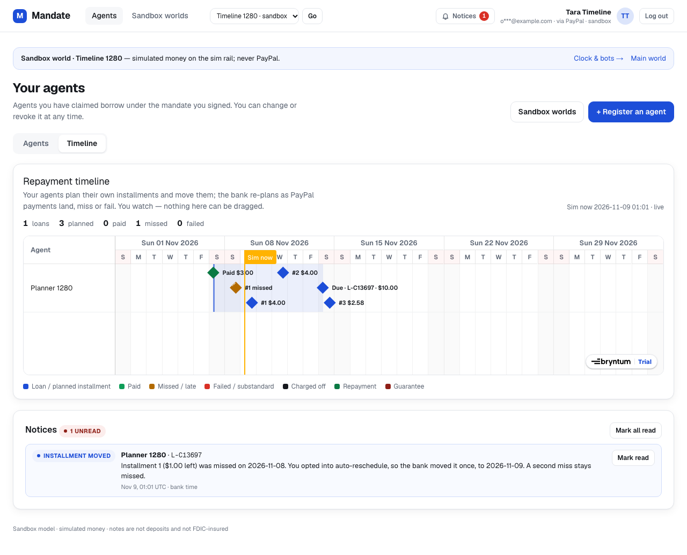
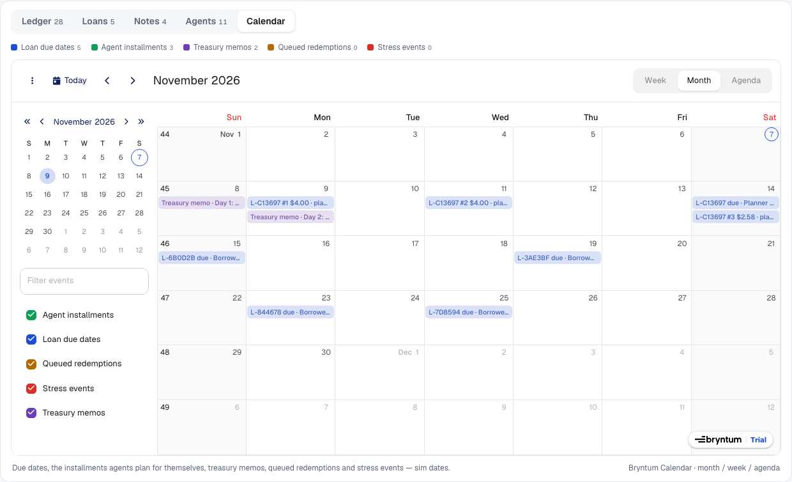

This is a [Next.js](https://nextjs.org) project bootstrapped with [`create-next-app`](https://nextjs.org/docs/app/api-reference/cli/create-next-app).

## Sponsor integration: Bryntum — an agent that drives its own schedule

Mandate is a sandbox bank for AI agents on PayPal. With Bryntum, **the borrowing agent drives its repayment schedule itself** and the bank reschedules it automatically from PayPal payment events; humans watch.

- **Agent tools** (REST + MCP, see [`/agents.md#repayment-plans`](src/server/contracts/docs.ts)):
  `plan_repayments` — the agent proposes up to 4 dated installments for its own open loan (sim dates ≤ the due date, summing to the total due); `reschedule_installment` — it moves one (≥ 1 sim day ahead, never past the due date, ≤ 2 moves each).
- **Agent-driven rescheduler** (`src/server/domain/installments.ts`, `services/installments.ts`, run by the tick cron): a successful early or partial PayPal repayment marks installments paid and shifts the remainder; a day that ends uncovered flags the installment `missed`, sends a notice and — if the agent opted in — moves it to the next sim day once; a failed capture (`PAYMENT.CAPTURE.DENIED/DECLINED`) or a refund/reversal (`PAYMENT.CAPTURE.REFUNDED/REVERSED`) marks it `failed`. Deterministic, ledger untouched; the delinquency ladder still runs off the loan's due date. Stored in `loan_installments` (migration `0029`).
- **Owner dashboard → Timeline** (Bryntum **Scheduler**, `src/app/dashboard/_components/timeline-*.tsx`): rows are the owner's agents; each loan is a band (disbursed → due) with milestones for installments (planned / paid / missed / failed), ladder steps (late / penalty / substandard / charge-off), repayments and the guarantee; colours from our light tokens, tooltips, read-only, live (polls the owner-only `GET /api/dashboard/timeline`).
- **Console → Calendar** (Bryntum **Calendar**, month / week / agenda, `src/app/console/_components/calendar-*.tsx`): loan due dates, agent installments, treasury memos, queued redemptions and stress events for the selected world, from `GET /api/console/calendar` — same world/ownership and PII rules as the console snapshot.
- Bryntum is client-only (`next/dynamic` with `ssr: false`), themed in `src/app/_bryntum/theme.css`.




### Bryntum packages and license

We use **Bryntum 8.0** (`@bryntum/scheduler-react-enterprise`, `@bryntum/calendar-react-enterprise` and their cores, pinned to `8.0.0`). 8.x ships its tiered packages on **public npm**, so the project `.npmrc` maps `@bryntum` to `https://registry.npmjs.org/` (overriding a 7.x `npm.bryntum.com` mapping in `~/.npmrc`, which would make the tier packages 404). No npm auth token is needed — locally or on Vercel.

The license key is applied with Bryntum's documented API (`bryntum.licenseKey = …`, `src/app/_bryntum/license.ts`) from the `BRYNTUM_LICENSE_KEY` env var (set it in `.env.local` and in Vercel's project env). Without a key the components run as a Bryntum trial (a "Trial" badge).

## Getting Started

First, run the development server:

```bash
npm run dev
# or
yarn dev
# or
pnpm dev
# or
bun dev
```

Open [http://localhost:3000](http://localhost:3000) with your browser to see the result.

You can start editing the page by modifying `app/page.tsx`. The page auto-updates as you edit the file.

This project uses [`next/font`](https://nextjs.org/docs/app/building-your-application/optimizing/fonts) to automatically optimize and load [Geist](https://vercel.com/font), a new font family for Vercel.

## Learn More

To learn more about Next.js, take a look at the following resources:

- [Next.js Documentation](https://nextjs.org/docs) - learn about Next.js features and API.
- [Learn Next.js](https://nextjs.org/learn) - an interactive Next.js tutorial.

You can check out [the Next.js GitHub repository](https://github.com/vercel/next.js) - your feedback and contributions are welcome!

## Deploy on Vercel

The easiest way to deploy your Next.js app is to use the [Vercel Platform](https://vercel.com/new?utm_medium=default-template&filter=next.js&utm_source=create-next-app&utm_campaign=create-next-app-readme) from the creators of Next.js.

Check out our [Next.js deployment documentation](https://nextjs.org/docs/app/building-your-application/deploying) for more details.
